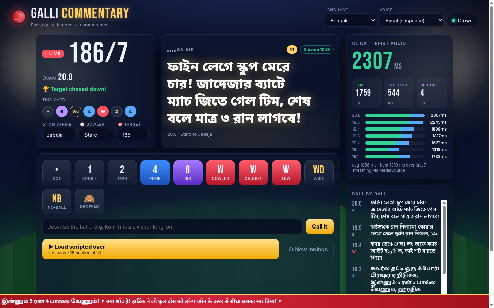
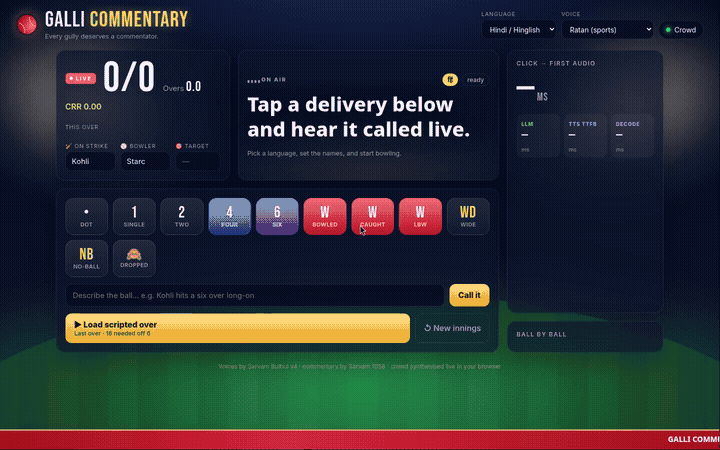

# 🏏 Galli Commentary

**Every gully deserves a commentator.** Tap what just happened on the ball ("SIX!", "Caught!", "Dropped!", or type *"Kohli hits a six over long-on"*). In under two seconds you hear it called live, in Hindi/Hinglish, Tamil/Tanglish, Telugu, Bengali or English. It sounds like a stadium commentator, not a screen reader.

Built for the Sarvam **"Build something that speaks"** challenge, on **Bulbul v4** streaming text-to-speech and **Sarvam 105B** for the commentary itself.





## Features

- **One-tap ball events**: dot, 1, 2, FOUR, SIX, wicket (bowled / caught / LBW), wide, no-ball, dropped catch. Keyboard shortcuts: `0 1 2 4 6 w c l x n d`.
- **Free-text calls**: describe any ball in plain words. The scoreboard infers the outcome (six, four, out, wide…) and the commentator calls exactly what you wrote.
- **Live scoreboard**: runs/wickets, overs, this over's balls as chips, CRR, or *need X off Y · RRR* once you set a target. Batter, bowler and target are all editable.
- **Scripted last over**: one click plays a 6-ball thriller (16 needed off 6). Each ball fires as soon as the previous call finishes speaking.
- **Switch language mid-over**: the next ball uses the new language and voice. Calls are written in native script, code-mixed with English cricket words, 1–2 punchy sentences. The commentator remembers the last 5 calls so it can build drama ("after that six, now a dot!").
- **Latency you can see**: a big *click → first audio* counter in ms, split into LLM time, TTS time-to-first-byte and decode, plus a stacked-bar history of the last 8 balls.
- **Progressive audio**: the mp3 stream plays as it arrives, through `MediaSource('audio/mpeg')`. Browsers without it fall back to a Blob.
- **Synthesised crowd**: a WebAudio crowd bed (filtered pink noise with a slow swell). It roars and claps on boundaries and wickets, groans at drops, ducks under the commentator, and can be toggled off. No audio files are shipped.
- **Stadium-night UI**: floodlights, pitch glow, a big commentary ticker and a scrolling news strip. Responsive down to small phones; respects `prefers-reduced-motion`.
- **Never silent**: if the LLM takes longer than 4s or fails, a built-in template line for that language and event is spoken instead. The ticker badge shows which source was used.

## How it works

```
 Browser (vanilla JS)                     Vercel functions (/api)                Sarvam
 ─────────────────────                    ───────────────────────                ──────
 tap "SIX"  ──► score + crowd roar
     │
     ├─ POST /api/commentary ───────────►  build prompt: language style,
     │   {event, names, score,             match situation, last 5 calls  ──►  /v1/chat/completions
     │    history, lang}                   4s timeout ─► template fallback  ◄──  sarvam-105b-conversations
     │  ◄──────────── {text, source, llmMs}
     │
     ├─ POST /api/speak ────────────────►  validate lang + speaker,
     │   {text, lang, speaker}             pipe upstream body as it      ──►  /text-to-speech/stream
     │  ◄═══ audio/mpeg chunks ═══════════  arrives (no buffering)     ◄═══  bulbul:v4-flash (mp3)
     │
     └─ MediaSource SourceBuffer ◄─ append each chunk ─► <audio> plays after the first chunk
            ▲ crowd bed ducks while the commentator speaks
```

The API key only ever lives in the server functions (`process.env.SARVAM_API_KEY`). The browser talks to `/api/*` and never sees the key.

## Bulbul v4 usage

The whole speech path is one streaming call, proxied straight through (`api/speak.js`):

```js
const upstream = await fetch('https://api.sarvam.ai/text-to-speech/stream', {
  method: 'POST',
  headers: { 'api-subscription-key': process.env.SARVAM_API_KEY, 'Content-Type': 'application/json' },
  body: JSON.stringify({
    text: 'छक्का! हार्दिक ने गेंद को स्टेडियम के बाहर भेज दिया!',
    target_language_code: 'hi-IN',
    speaker: 'ratan_hi_sports',
    model: 'bulbul:v4-flash',
    enable_preprocessing: true,
  }),
});

res.setHeader('Content-Type', 'audio/mpeg');
const reader = upstream.body.getReader();
for (;;) {
  const { done, value } = await reader.read();
  if (done) break;
  res.write(Buffer.from(value)); // forward each mp3 chunk the moment it lands
}
res.end();
```

Voices used (all `bulbul:v4-flash`):

| Language | Speakers |
| --- | --- |
| Hindi / Hinglish `hi-IN` | `ratan_hi_sports`, `simran_hi_social_excited`, `sunny_hi_reels`, `ritu_hi_reels`, `shubh_enhi_ads` |
| Tamil / Tanglish `ta-IN` | `aravind_ta_ads`, `gokul_ta_narration` |
| Telugu `te-IN` | `tarun_te_narration`, `kavitha_te_conversation` |
| Bengali `bn-IN` | `bimal_bn_suspense`, `arnab_bn_conversation` |
| English `en-IN` | `ashwin_en_sports_energetic`, `shubh_en_sports`, `ritu_en_reels` |

## Latency notes

Measured locally against the live APIs (see `npm test`):

| Stage | Typical |
| --- | --- |
| Commentary (`sarvam-105b-conversations`, ≤120 tokens) | 0.45–1.5 s |
| Bulbul v4 stream, time to first byte through the proxy | ~0.4–1.1 s |
| First chunk appended → `<audio>` playing | < 15 ms |
| **Tap → first audio heard** | **~1.5–2.4 s** |

What keeps it fast:

- **Stream, don't buffer.** `/api/speak` forwards bytes as they arrive, and the browser starts playback after the first mp3 chunk via MediaSource. Speech starts long before synthesis finishes.
- **Short calls.** The prompt asks for at most 2 sentences / 30 words, and the server trims anything longer. Less text means fewer tokens and faster audio.
- **A non-reasoning chat model.** `sarvam-105b-conversations` answers directly. A reasoning model would spend the latency budget thinking.
- **Hard 4s LLM timeout** with per-language templates, so a slow model never leaves dead air.
- **Instant feedback.** The scoreboard and crowd roar react on tap, so the 1–2 s wait still feels live.

## Run locally

Requires Node 18+. There are no dependencies to install.

```bash
export SARVAM_API_KEY=your-key        # or put it in .env (see .env.example)
node dev-server.js                    # http://localhost:3000  (PORT=xxxx to change)
```

`dev-server.js` serves `public/` and runs the very same `api/*.js` handlers that Vercel runs.

Smoke test (boots the server and calls commentary + speech for every language):

```bash
npm test                               # one voice per language
node test/smoke.js --all-speakers      # every verified voice
```

## Deploy (Vercel)

```bash
vercel                                 # first deploy / link the project
vercel env add SARVAM_API_KEY          # paste the key (Production + Preview)
vercel --prod
```

Static files are served from `public/` (see `vercel.json`); `api/*.js` become Node serverless functions. There is no build step.

## Environment

| Variable | Required | Purpose |
| --- | --- | --- |
| `SARVAM_API_KEY` | yes | Sarvam API subscription key, read only by `/api/commentary` and `/api/speak`. Without it the app still runs, with template commentary and no audio. |
| `PORT` | no | Local dev server port (default `3000`). |

## Project layout

```
api/            serverless functions: commentary.js, speak.js, config.js
lib/            shared server code: languages + speakers, events, fallback templates, http helpers
public/         index.html, styles.css, js/app.js (UI), js/player.js (streaming audio), js/crowd.js (WebAudio crowd)
dev-server.js   zero-dependency local server
test/smoke.js   end-to-end API check
```
